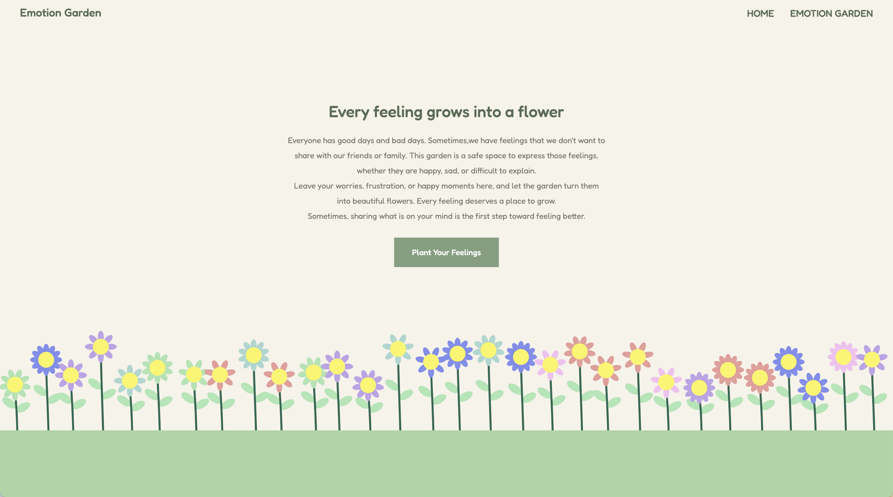
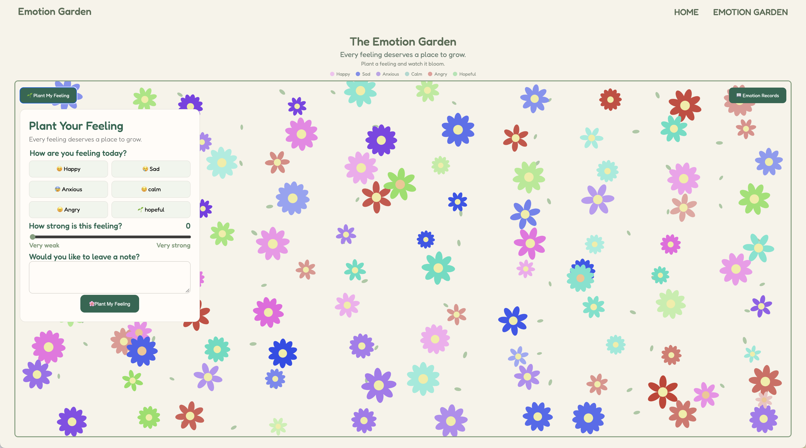
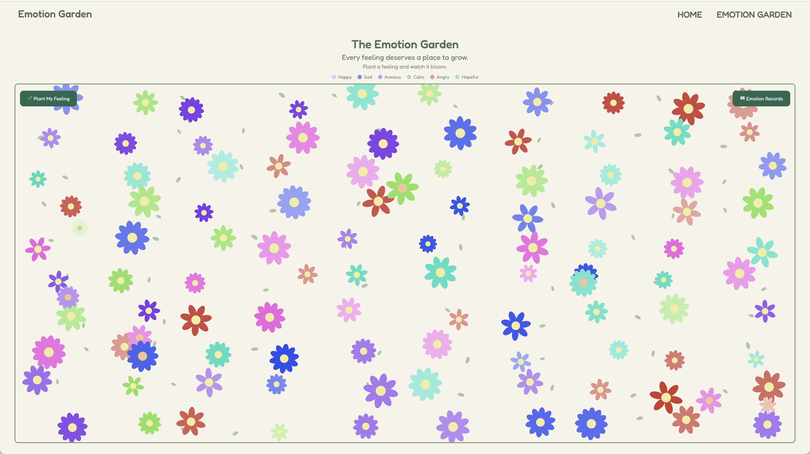
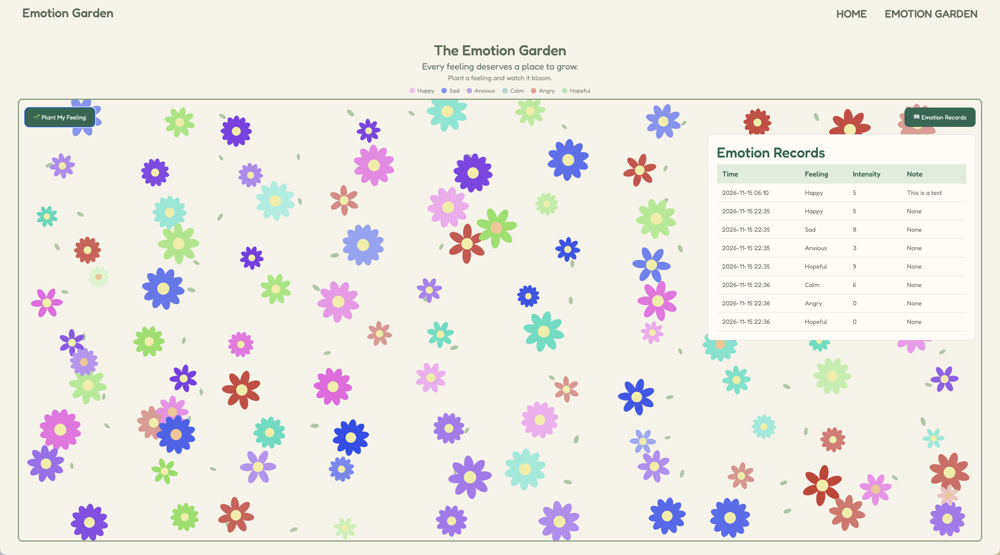
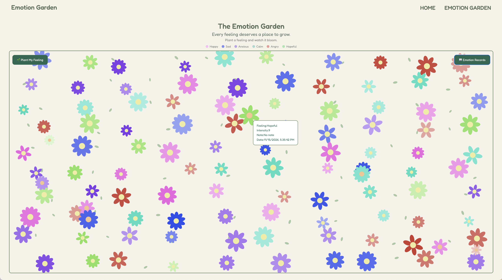

# Emotion Garden - CART-351-MINI-PROJECTS
WEINI WANG

Emotion garden is an interactive website where people can express their feelings by turning them into flowers. Each flower represents an emotion, and its color,size, and rotation speed change based on the feeling and its intensity. 

## Project Description 

Emotion Garden started with a simple idea: everyone has feelings they want to share, but sometimes it is difficult to say them out loud. People may not know how to explain their feelings or may not want to talk to friends and family about them. I believe that expressing a difficult feeling can make it a little lighter. It may not solve the problem, but it can be a first step toward feeling better. I waned to make a space where people could leave their thoughs without needing to stat a conversation. I also wanted to remind visitors that they are not the only people who experience sadness or anxiety. 

I chose flowers becuase they remind me of emotions. Flowers have different colors and change with their surrounding. They bloom in sunshine and can wilt in bad weather. Similarly, our feelings can be bright one day and quiet the next. I wanted every emotion to have a plave in the garden. A sad flower matters just as much as a happy one. 

Emotion Garden is an interactive website built with HTML,CSS,JavaScript,p5.js,Python Flask, and JSON. Users can choose Happy, Sad, Anxious, Calm, Angry, or Hopeful, select an intensity from 0 to 10, and leave an optional note. Each feeling has a base color. I use p5.js map() to turn intensity into flower size and rotation speed, and lerpColor() to mix the emotion color with white. Lower intensity creates a lighter color and a smaller, slower flower. I wanted viewers to see the strength of a feeling instead of only reading a number.

New emotion flowers move through three animation stages: growing, plusing, and spinning. Random values change their positions and numbers of petals, so the garden does not look eactly the same each time. For the background, I divide the canvas into a grid and add small random offsets to spread decorative flowers more evenly. I use noise() to give the leaves gentle movement. I looked at son's flowers sketch for drawing flowers from simple shapes and maileenb's moving-grass sketch for moving plants. 

The project also connects the browser to Flask. When a user plants a feeling, JavaScript sends its data through a POST request. Flask saves the emotion, intensity, note, and time in a JSON file. When the garden is opened again, the saved records are loaded and turned into flowers. Visitors can hover over these flowers to read their information, and they can review past entries in the Emotion Records table. I wanted thhis record feature becuase a happy note from an earlier day might offer comfort during a difficult moment. 

Two course readings helped me think about the limits of this process. In The Point of Collection, Mini Onuoha explains why the way we collect information matters. My form offers only six emotions and a number from 0 to 10, even though real feelings are more complicated. The optional note allows people to say more in their own words. Hito Steyerl's A Sea of Data made me think about how we interpret patterns. A big, fast-moving flower may suggest a strong feeling, but it cannot show the full story behind it. The flowers are viual translations of what users choose to share, not an automatic disagnosis or AI emotion recognition. 

My expected outcome is a gentle garden where people feel comfortable expressing themselves. I hope visitors can look back at happy memories, accept difficult emotions, and see that many different feelings can exist together. A flower cannot fix a problem, but it may offer a small moment of comfort and remind someone that they are not alone. 

## Project Screenshots

1. Home Page

2.Plant Your Feeling Form 

3.Emotion Garden 

4.Emotion Records 

5.Hover Tooltip

## References and Resources 

# Course Readings

Onuoha, Mimi. (2016). The Point of Collection. Data & Society.

Steyerl, Hito. (2016). A Sea of Data: Apophenia and Pattern (Mis-)Recognition. e-flux Journal, Issue 72.

# Visual References

[flowers by son](https://editor.p5js.org/son/sketches/SkJJxG2Cm) — Reference for creating flowers using simple shapes in p5.js. 

[moving-grass by maileenb](https://editor.p5js.org/maileenb/sketches/Dlyu4Sp6v) — Reference for gentle plant movement.

